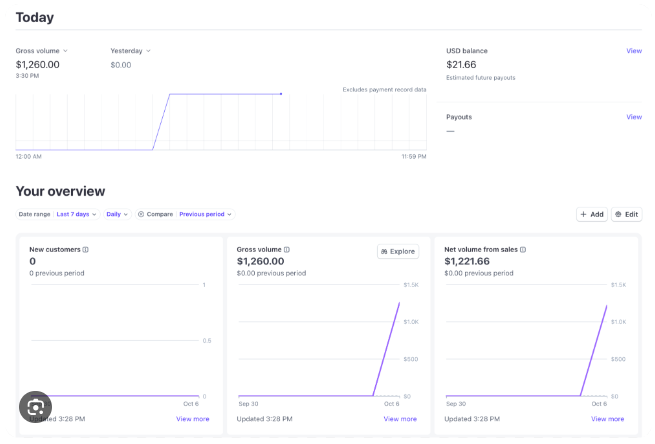
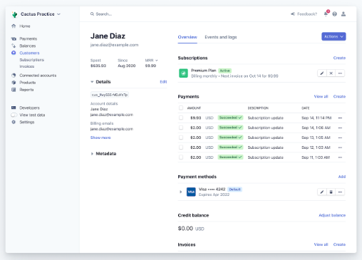
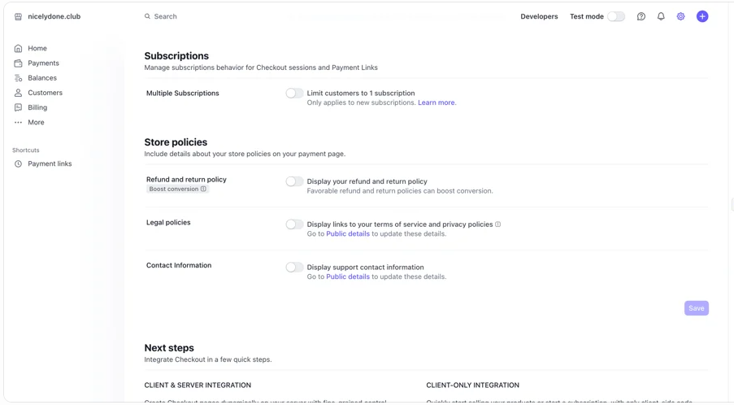
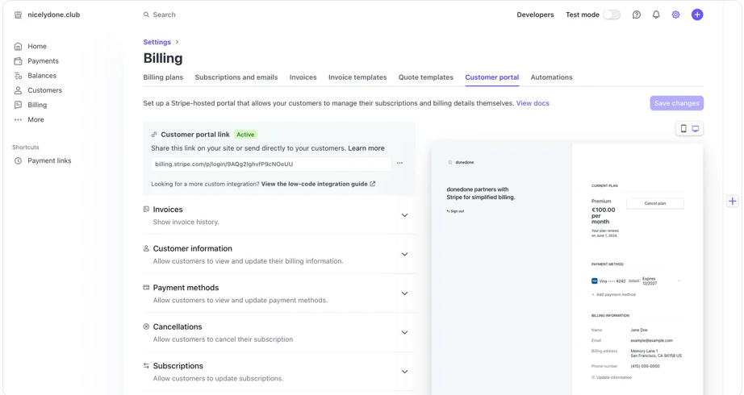
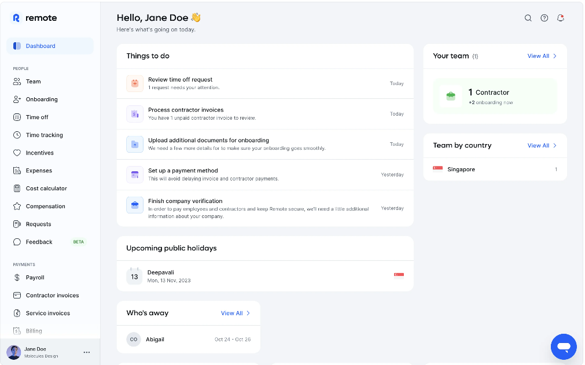
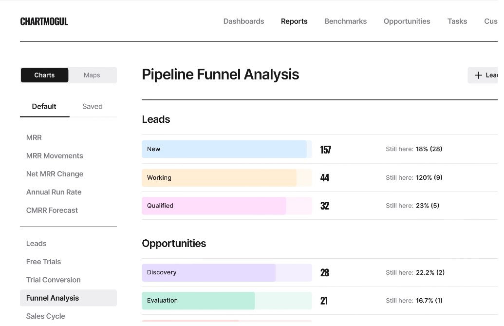
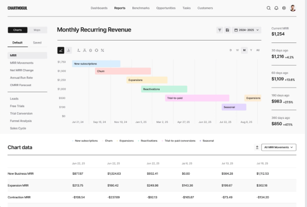

# Design references

This document collects visual references for Pulse, a SaaS analytics
dashboard built with Norte.

The notes describe observable interface patterns and ideas worth exploring.
They are not final design decisions or evidence of usability.

Screenshots belong to their respective owners and are included for
reference and commentary.

## Stripe

Source: Nicelydone — [Stripe reference](https://nicelydone.club/library/apps/stripe)

### Overview

| Field | Notes |
| --- | --- |
| What stands out | A prominent daily summary sits above a group of metric cards. Typography, spacing, and restrained color distinguish primary values from supporting information. |
| Potential application | Explore a clear relationship between a primary business question and supporting metrics, with visible reporting periods and comparisons. |
| Limitations | A daily financial summary may not be the right priority for Pulse. MRR and churn may need a different reporting period. |

### Customer detail
Source: Nicelydone — [Stripe reference](https://support.stripe.com/questions/manage-a-customer-s-information-and-payments)

| Field | Notes |
| --- | --- |
| What stands out | A narrow customer summary sits beside a wider area for subscriptions, payments, and related information. Actions appear near the sections they affect. |
| Potential application | Separate customer identity and key attributes from metrics and activity, allocating space according to the content. |
| Limitations | This is a detail page, not a customer list. Payment methods, balances, and invoices are not automatically part of Pulse's scope. |

### Settings

Source: Nicelydone — [Stripe reference](https://nicelydone.club/library/screens/9b0272f6-6d11-4c80-8a4b-5f55f8aa9833)

| Field | Notes |
| --- | --- |
| What stands out | Settings are grouped under headings and descriptions. Repeated alignment, subtle dividers, and spacing establish a consistent structure. |
| Potential application | Group related preferences and place explanations close to their controls. |
| Limitations | The screenshot does not establish interaction behavior, accessibility, or whether the subtle separation beside the sidebar is produced by a shadow. |

### Billing

Source: Nicelydone — [Stripe reference](https://nicelydone.club/library/screens/065efc9c-25b6-4c30-952b-5c7ca928ef44)

| Field | Notes |
| --- | --- |
| What stands out | The selected tab uses color and an underline. Configuration sections combine icons, labels, descriptions, and chevrons beside a portal preview. |
| Potential application | Explore clear selected states and concise grouping of related settings. Icons can support labels without replacing them. |
| Limitations | The sections appear expandable, but their behavior cannot be confirmed from the screenshot. A preview panel is useful only when the task calls for one. |

## Remote

Source: Nicelydone — [Remote reference](https://nicelydone.club/library/apps/remote)

| Field | Notes |
| --- | --- |
| What stands out | White cards sit on a light gray background. Card size and position establish priority. The sidebar has a distinct surface, and the selected navigation item uses a tinted background and blue accents. |
| Potential application | Explore clear content grouping, a recognizable navigation selection, and a distinction between primary and supporting content. |
| Limitations | This is a task-oriented HR dashboard. Its layout should not be assumed to suit revenue analysis, and excessive cards could fragment related metrics. |

## ChartMogul — independent redesign

Source: Dribbble — [Taras Migulko], [Redesign post](https://dribbble.com/shots/26524685-Chartmogul-dashboard-redesign-before-and-after)

These images show an independent redesign concept, not a verified
production interface from ChartMogul.

### Funnel report concept

| Field | Notes |
| --- | --- |
| What stands out | Dark headings, values, and selected controls contrast with pale category colors. Heavier and lighter dividers separate different levels of content. Numeric values have a distinctive condensed appearance. |
| Potential application | Explore selective contrast, clear typographic roles, and restrained category colors. |
| Limitations | The funnel categories are not equivalent to Pulse's KPIs. The screenshot does not explain the scale or meaning of the bar lengths. |

### MRR report concept

| Field | Notes |
| --- | --- |
| What stands out | A current metric appears beside historical comparisons. Reporting controls sit near the chart, and a data table provides a more detailed view below. |
| Potential application | Explore metrics with temporal context, controls placed near the content they affect, and access to exact values when needed. |
| Limitations | The chart's visual encoding is not clear from the image. The relationship between chart and table cannot be verified, and several icon-only controls have unclear meanings in the screenshot. |

## Initial direction to explore

- Use typography, spacing, and alignment to establish hierarchy.
- Use subtle dividers and neutral surfaces to group information.
- Apply color intentionally to selection, categories, or meaningful states.
- Present metrics with a clear reporting period and relevant comparisons.
- Keep detailed information available without giving everything equal emphasis.

These are exploration directions, not approved visual specifications.

## Open questions

- Which business question should lead the Overview page?
- Which customer attributes and activities belong on the detail page?
- What customer-list patterns should we study for search, filtering,
  and sorting?

A customer-list reference can be added when that page is explored.
